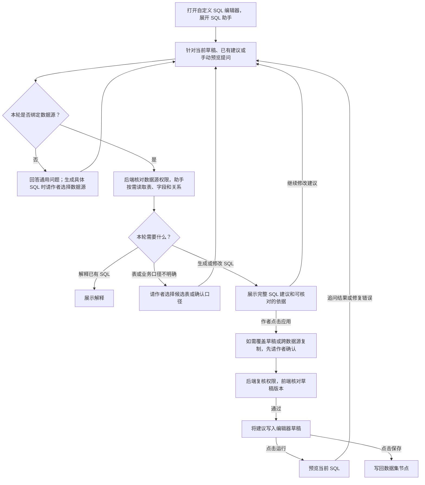
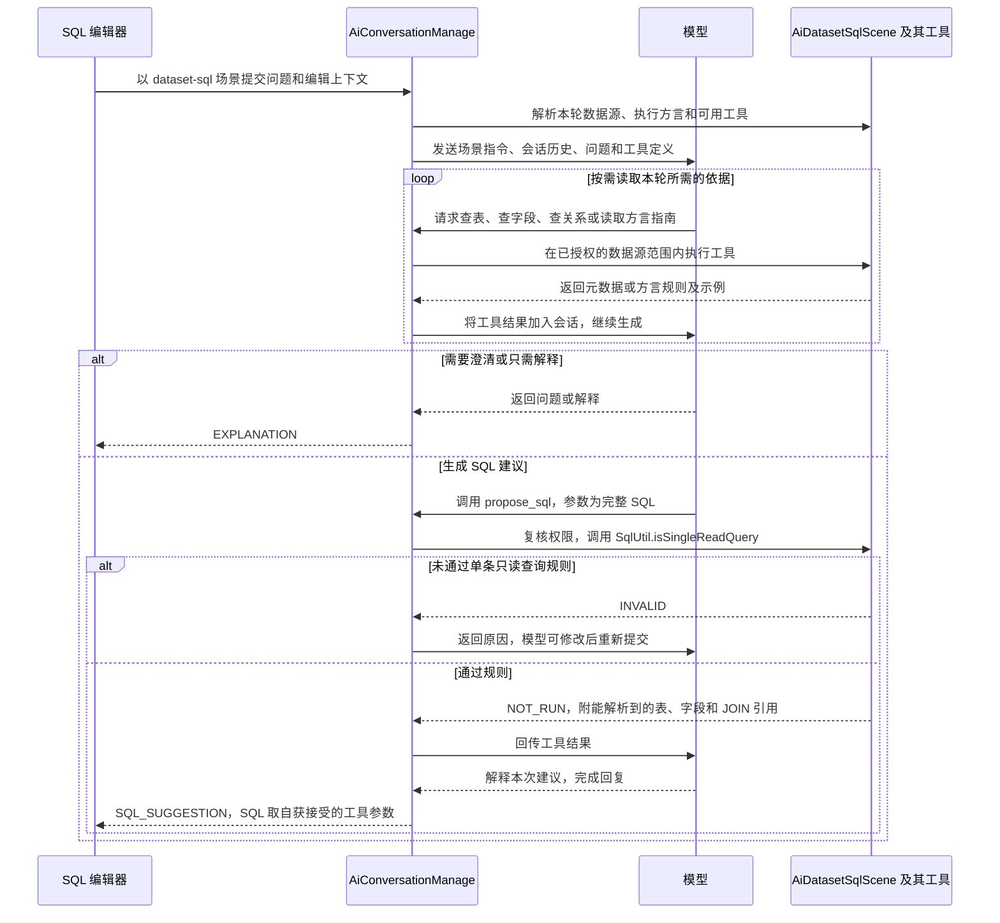

# AI 对话助手开发说明

本文描述数据集自定义 SQL 编辑器和计算字段抽屉的多轮会话、工具执行与增量输出，以及数据源详情页的[表关联与语义后台任务](#数据源表关联与语义后台任务)。同步 `ChatModel.call` 接入另见 [基础 AI SDK](sdk-handoff.md)。以下源码路径相对于仓库根目录，数值边界以当前实现为准。运行回归前读取 [AI 服务验证说明](../../tests/ai-service/README.md#对话助手回归)。

自定义 SQL 编辑器和计算字段抽屉使用平台已认证的 WebSocket 接收前台增量。
提问、停止、手动重试、应用核验沿用 HTTP。
STOMP 订阅 `/app/ai/conversation` 时，服务端向该连接的订阅返回一次性凭据。
浏览器调用
`POST /ai/conversations/{id}/executions/{execution}/subscriptions`
提交凭据、编辑器 ID 和已有游标，服务端核验当前 HTTP 身份、执行归属、资源权限及握手凭据。
每批内容经原执行的交付权限校验后，定向发送到对应连接及订阅。
事件序号用于去重、排序及缺口补读。
超过单帧大小的内容由同一鉴权事件接口补读。
执行状态和订阅保存在所属进程内存中，多节点部署应将编辑活动的 HTTP 和 WebSocket 路由至同一节点。
推送断开时，编辑器先从已读游标查询原执行。
运行期间按新内容调整补读间隔（0.5 至 2 秒），并定期重试订阅。
WebSocket 和 HTTP 指向不同节点时，可由原节点的 HTTP 补齐。
事件请求落到其他节点会收到可重试的路由错误。

收起助手保留订阅。
连接断开时给予原执行 30 秒宽限，服务端继续遵守原模型调用期限。
通过已绑定连接收到的回执和通过鉴权的游标读取可以续约。
宽限先到时，服务端结束执行，保留已授权的部分回答及手动重答入口。
原调用先到期时记录模型超时。
进程重启会丢失临时执行。
原节点持续不可达时，编辑器提示状态未确认，恢复联网后可继续核对。
主动新对话或关闭编辑器会释放旧订阅并结束该会话。

## 按历史步骤追问

数据集 SQL 和计算字段编辑器按每条回答中的实际工具调用顺序编号。
工具开始、结束或重连补读时沿用同一号码。手动重答另起一条回答，从步骤 1 开始。
例如，「步骤 1 里的 paid_at 和 created_at」在最近一次回答内查找；
「第一次回答的第 1 步」指定原回答，即使作者之后重答过也能区分。

服务端在会话有效期内保存原调用的状态和结果。已经完成的步骤可以在回答中止后继续引用。
取用原结果前复核当前身份、工作空间、场景及原资源权限。
SQL 追问选取相关字段。计算字段追问返回原步骤提交的公式和当时的校验结论，
私有字段绑定留在服务端。作者修改草稿后，需要重新校验才能得到新草稿的结论。

前台每次提问（含一次性辅助、同步 turns 和手动重试）受理时重新检查一次当前用户启用状态及 AI 使用资格，校验当前 AI 开关及适用空间策略，并固定模型、凭据、输入/输出限额、超时、恢复及审计配置。该轮模型请求、自动重试和工具续调使用同一快照，不因模型编辑、全局/空间 AI 关闭或关闭后重开而换模或失效；下一次提问和手动重试读取最新配置。已受理操作的幂等重发只核对原执行，不创建新快照。前台增量读取、结果应用和活动巡检不再查询用户启用状态、AI 设置、空间策略或模型配置。打开新上下文及资源列表入口仍检查当前使用资格；继续在同一上下文提问必须重新检查，不以会话已存在代替新提问准入。

后端临时会话扫描每秒先按内存中的有效期清理过期会话；仅对存在活动执行的会话继续检查期限、读取租约及当前身份/资源权限。空闲会话、已退役上下文和已完成的一次性结果不在扫描中查库。HTTP 当前身份/空间不匹配、部署模式变化或资源撤权仍拒绝访问或清理会话；空闲期间在下一次受保护操作发现这些变化。账号中途停用不再通过 AI 自己的巡检终止已受理前台回答，而是在下一次提问/手动重试时拒绝。接口原有登录认证不变。AI 配置变化不清空会话历史，原有停止、关闭、超时和丢失客户端租约处理保持。

前台保存仅由服务端成功校验后生成的使用资格凭据，随受控上下文/执行保存，不接受客户端传入。每次业务边界显式安装该凭据，同身份的嵌套使用资格检查复用受理结果；账号、空间、代理和部署版本必须精确匹配。资源 READ、资源版本和历史范围继续实时检查，配置管理权限不复用。部署模式及版本仍在作用域前后检查；线程局部状态在正常/异常退出时清理，嵌套退出恢复上一层，不自动传播到其他线程。新提问/手动重试即使处于旧作用域内，也强制重新读取使用资格。普通后台任务、原生 SDK 和管理员入口保持各自检查规则。

固定执行配置不固定系统并发容量：每次实际模型 HTTP 请求仍通过当前全局容量准入，配置发布的短暂屏障最多等待 1 秒，持续阻断或容量已满仍拒绝。容量读取仅发生于发送前，不发生于吐字/轮询。持久后台任务及通用原生 SDK 的动态策略规则不变；它们的每次使用策略版本校验共享一次全局配置和一次适用空间策略读取，社区身份不读取空间策略。

## 编辑器提示词与回答语言

服务端在受理每轮时从请求的 `Accept-Language` 读取界面语言，拼装编辑器共享提示词、本轮界面语言、当前场景提示词和已授权的业务输入。模型根据作者的原文和话题判断明确语言要求的作用域。一次性要求结束后恢复有效偏好；转入新话题后恢复对话偏好或界面语言。新对话从当前界面语言开始。业务工具的校验续调沿用本轮上下文。

编辑器会话超过六组已完成问答，或历史正文超过 6000 个 Java 字符时，下一次提问开始压缩。上游最多收到最近三组完整问答（合计 3200 字符），另附较早作者陈述中的短句、已确认的答复和选中的澄清选项。数字选择恰好跨过保留范围时，摘要也会补入对应选项。每组摘录保留完整短句，单组最多约 384 字符；代码块和过长的句子会被略过。语言要求的有效范围仍从原提问算起。步骤快照独立按权限检索，历史资源范围的下标按实际发给模型的消息计算。

正式编辑器在提问受理时标记依据来自草稿、编号建议、手动预览或空引用，并记录它当时与草稿是否一致。选回先前建议时只发送本轮引用的 SQL 或公式。后续有依据的追问可沿用上次选定建议的编号及原文；超过 2048 字符的建议只保留编号和省略标记，作者选回它即可按本轮依据提供全文。取消本轮引用仍可沿用早先确认的口径。

三份 UTF-8 Markdown 资源位于 `core/core-backend/src/main/resources/ai/prompts`。维护共通的澄清、回答语言和步骤引用规则时修改 `editor-shared.md`；SQL 和计算字段专属规则分别在 `editor-dataset-sql.md` 和 `editor-calc-field.md`。

按名称、字段或执行动作追问时，会话工具 `find_historical_step` 在当前权限下查找原回答。唯一结果只发送本题相关的证据；同名数据源或不同公式版本可用来源名或回答与步骤号区分。询问最后一次校验时跳过中间的解释。作者要求重新校验当前公式时，`revalidate_current_formula` 直接校验发问时固定的草稿。

SQL 助手补查或刷新点名字段时使用 `get_named_table_fields`。H2、MySQL、MariaDB、TiDB、PostgreSQL、GaussDB、Kingbase、Oracle、SQL Server、Db2、ClickHouse、已配置 schema 的 Redshift 和使用原生列目录的 Doris、StarRocks 会在当前表的目录查询中绑定字段名。文件、API、扩展及只提供整表元数据的连接器（如 Impala 的 DESCRIBE、Mongo 和外部 catalog）沿用已授权的表读取，再按物理列名筛选。

本轮只返回所问字段和已确认缺失的字段。SQL 建议的依据合并建议前的整表和按名读取，按核验先后更新对应字段。历史追问字段数量时只给出原步骤的字段数和覆盖范围。局部读取保留该次返回数量，中止且未产出结果的步骤无法给出数量。作者明确刷新整表时使用整表工具。

## 数据集自定义 SQL 编辑器

新增自定义 SQL 节点和编辑已有节点都从 `DatasetUnion.vue` 打开 `AddSql.vue`。作者在弹框中展开「SQL 助手」后，可针对完整草稿提问。收起面板会保留本次对话，关闭弹框会结束编辑活动。身份、工作空间和资源读取权限沿用共享会话的检查。

每条建议标明本轮采用的 SQL 版本。作者可沿用尚未应用的上一版、改写手动编辑后的草稿，或选回指定的建议。点击「应用」时，后端复核原建议的交付权限。草稿已有不同内容，或建议源与当前数据源不同时，编辑器会提示确认。应用只替换 CodeMirror 中的整段 SQL。作者手动点击「运行」才会预览，点击「保存」才会写回节点。

正式入口的场景码为 `dataset-sql`。查找表时优先使用点名表、已有 SQL 引用和本地登记的语义。
需要补充物理表时，按表名或备注搜索，一次最多展示五个候选。
选定表后读取实时字段，再附上可核对的已确认业务含义和取值映射。
每条 SQL 建议先显示可展开的「用表与字段依据」，下方显示建议编号、SQL 和操作按钮。
单源模式使用实际执行引擎的方言，跨源模式使用 Calcite；一个 SQL 节点始终绑定一个选中数据源。
跨库关联由作者在数据集画布上配置。

编辑器将可用系统变量的显示名提供给助手，应用 SQL 后仍通过原参数设置配置类型和默认值。作者追问一次手动运行时，助手接收对应版本的 SQL、执行模式和结果状态。失败原因使用分类摘要，预览明细和变量实值留在原业务流程。修复建议也需要作者确认应用并手动重跑。

正式抽屉的浏览器回归入口为 `npm --prefix tests/browser test -- --config=playwright.dataset-sql-assistant.config.cjs`。用例从数据集编辑界面打开真实抽屉，使用合成 API 响应。后端会话与工具行为通过 `tests/ai-service/run.py --recovery-tools` 的受控模型 HTTP 链路验证，依赖准备见下方 AI 服务验证说明。

### 从提问到应用 SQL 草稿



追问预览时，助手收到的是运行当时的 SQL、数据源、模式和结果状态。即使作者后来改了草稿或切换了数据源，也能区分这次预览和当前编辑内容。预览结果行留在编辑器内。

### 一条 SQL 建议在代码中如何生成



场景指令要求模型在生成或修改 SQL 前调用 `read_sql_guide`。提示词与工具共用方言名称解析逻辑。内置连接器取数据源枚举的名称，已加载的插件取配置中的 `name`。例如达梦单源查询的执行方言是“达梦”，同一个连接器在跨源模式下的执行方言是 Apache Calcite。Excel 和 API 数据源使用配置的数据引擎方言。[场景指令](../../core/core-backend/src/main/java/io/dataease/ai/scene/sql/AiDatasetSqlScene.java) · [方言指南](../../core/core-backend/src/main/java/io/dataease/ai/scene/sql/DatasetSqlGuide.java)

图中的 `propose_sql` 属于正式编辑器的 `dataset-sql` 场景。`NOT_RUN` 表示候选 SQL 已通过单条只读规则，可供作者应用；实际数据库执行由作者点击“运行”触发。通用 `sql` 场景注册了另一个同名工具，使用静态校验器的 `PASS` 作为可应用条件。[建议结果组装](../../core/core-backend/src/main/java/io/dataease/ai/scene/sql/AbstractSqlConversationScene.java) · [通用 SQL 工具定义](../../core/core-backend/src/main/java/io/dataease/ai/tool/sql/AiSqlTools.java)

## 目录与扩展位置

后端根目录为 `core/core-backend/src/main/java/io/dataease/ai/`，按执行机制、具体场景、可复用工具和 HTTP 入口区分：

```text
ai/
├── engine/
│   ├── conversation/  # 会话管理与场景扩展接口
│   ├── runtime/       # 模型执行、传输、准入、提示词约束、工具协议与恢复
│   └── task/          # 后台任务、调度、租约与结果投递
├── scene/
│   ├── datasource/    # 数据源表关联发现与语义补全
│   ├── sql/           # SQL 上下文、工具选择与建议结果
│   └── structure/     # 受控结构说明、结构快照与资源互斥验收
├── tool/
│   ├── datasource/    # 授权元数据读取、表/字段及选中结构工具
│   └── sql/           # SQL 静态校验与建议工具、校验器生命周期
├── configuration/    # AI 设置、模型配置、发现与连接测试
├── security/
│   ├── identity/      # 身份、部署许可与后台身份作用域
│   └── credential/    # 密钥材料、初始化、加解密与签名证明
├── audit/            # 执行审计、证据与缺口修复
├── retention/        # 审计及任务结果的留存清理
├── server/           # 既有 HTTP 入口
├── support/          # 跨模块错误码与异常转换
├── dao/              # 持久化实体与仓储
└── service/          # 既有 AI 基础服务
```

后端已取消笼统的 `manage/` 目录；类名暂时保留既有命名，Spring Bean 名、HTTP 路径和持久化格式不变。配置或安全能力修改应进入对应职责目录，不重新建立集中业务逻辑目录。`AiOutboundPolicy` 处理模型地址规范化和端点路径，随传输放在 `engine/runtime/`，不把它当作资源授权模块。

SDK 的 `AiOwnerContext` 统一位于 `sdk/common/src/main/java/io/dataease/ai/security/identity/`，身份安装仍为包内方法，只由经过校验的核心身份作用域调用。旧 `manage` 路径及兼容转发类已删除，主仓库与 XPack 消费者统一迁移到同一个类。本次是包路径变更，需要 SDK、核心和 XPack 配套重新构建与交付，不支持混用旧扩展二进制；HTTP 路径和持久化格式不变。

新增场景适配放到对应的 `scene/<业务场景>/`。对话场景通过 `AiConversationScene` 定义业务上下文、授权、允许的工具集合与结果；注册由 `AiConversationManage` 收集 Spring 场景 Bean 并按 `code()` 分发。可复用工具实现放到 `tool/<业务领域>/`，场景显式组合所需工具，不依赖另一个具体场景。

包名迁移后，本地开发应由 IDE 执行后端模块 Rebuild 再启动，或使用项目适用的干净模块构建；普通增量编译可能留下旧包的 Spring 组件。不要手改生成类或启动两个不同包下的同名旧/新组件。

## 场景与可复用工具

`AiTool<C>` 将工具定义、参数名、重试安全声明和执行实现绑定在一起，`C` 是服务端准备的类型化资源范围，不来自模型参数。工具执行统一检查参数形状、取消与截止时间；模型协议、累计预算、恢复、事件和审计仍由共享引擎负责。工具模块不依赖 `AiConversationScene` 或会话历史，也不从客户端接收身份和模型配置。

- `AiDatasourceTools` 提供经过既有 DE 权限链校验的资源列表、数据源版本、表和字段投影，并提供 `list_tables`、`get_table_fields`、`inspect_structure` 工具。SQL 与结构场景共用同一模块；内部直接使用类型化数据，不通过调用另一个场景并解析工具 JSON 复用能力。
- `AiSqlTools` 提供 `validate_sql` 和 `propose_sql`，共用 `tool/sql/AiSqlStaticValidator`。解析线程池由该 Spring Bean 管理并在销毁时关闭，不再由 SQL 场景持有。
- SQL 场景明确选择表、字段、校验及建议工具；未绑定数据源时不开放工具。结构场景只开放 `inspect_structure`，传入服务端绑定的选中表范围，保留结构指纹、历史快照兼容和资源互斥规则。
- `propose_sql` 负责返回静态校验结论；只有 PASS 才形成可应用建议、原编辑器及草稿版本绑定、确认应用等规则继续由 SQL 场景和既有应用入口负责。

工具存在或可注入不表示模型有权调用。引擎仍以 `scene.tools(context)` 的允许集合验证模型请求；scene 的执行分派只能选择该场景组合的工具，工具中的资源操作继续复核真实权限和版本。新增场景可复用现有工具，但必须准备自己的可信范围及授权，不能直接开放全部 Spring Bean 或绕过共享执行生命周期。

工具提取保留了原有工具名称、参数和持久任务上下文格式。`inspect_structure` 仍使用原有物理结构投影计算指纹，旧任务可继续校验。后端运行前重新构建当前源码以加载新的工具 Bean；SQL 校验器旧路径的内部 Java 使用方需要更新 import。

## 数据源表关联与语义后台任务

在数据源详情页，拥有该数据源管理权限的用户可以从「表关联」或「语义管理」发起生成。数据表入口面向具有类型的非文件夹数据源，包括 Excel 和 API。模型输入使用所选表的表名、字段名、类型和备注，语义补全还标明待填属性。两个场景都不读取样本行。

| 页面操作 | 选择范围 | 生成与确认 |
| --- | --- | --- |
| 表关联 → AI 发现关联 | 同一数据源的 2–50 张物理表 | 一次提交所选表的结构，推断等值关联、基数和连接类型。写入前重新读取表结构，核对两端表和字段，按表对及连接条件去重，调换左右表也视为同一关联。通过校验的新记录写入表关联列表，等待人工确认。 |
| 语义管理 → AI 补全语义 | 已加入语义管理且当前可用的 1–50 张表 | 逐表补全表描述、数据粒度，以及字段的业务名称、描述和别名。写入前复核物理结构和语义记录，只填未确认记录的空白属性，保留已有内容和确认状态。字段取值参考由人工维护。 |

两个场景由 `AiDatasourceMetadataScenes` 注册为 `AiBusinessTaskScene`，场景码分别为 `datasource-relations` 和 `datasource-semantics`。前端共用 `DatasourceMetadataAi.vue` 抽屉。业务接口为 `/datasource/metadata/{datasourceId}/ai/{kind}`，`kind` 取 `RELATION` 或 `SEMANTIC`。用 POST 提交表名数组，用 GET 查询状态。两种操作都校验数据源管理权限。

任务按数据源和生成类型互斥。同一类型已有任务排队或运行时，即使改选了表，再次提交也会返回现有任务。两种类型可分别受理，共享后台调度容量。关闭抽屉后任务继续执行。再次打开时，不带 `taskId` 的 GET 可找回当前活动任务。有管理权限的其他用户也能查看其状态。抽屉拿到 ID 后按 ID 轮询至终态并刷新业务列表。

模型调用通过任务引擎的 `Execution.call` 发起，`Execution.write` 在同一事务内写入业务元数据和累计摘要。关联发现按批写入，摘要按新增和跳过的关联条数统计。语义补全按表提交，`written` 统计有更新的表记录和字段记录，`skipped`、`failed` 按表计数。部分表失败时，已提交的建议仍可在语义管理页核对。抽屉终态为 `SUCCESS`、`PARTIAL` 或 `FAILED`。

## 编辑器与数据源入口

数据集作者从自定义 SQL 编辑器或计算字段抽屉打开助手。数据源维护者从数据源详情的「表关联」或「语义管理」提交后台任务。

## HTTP 契约与事件

The shared SDK exposes `/ai/conversations`: `GET /resources`, `POST` to open a
context, the compatible synchronous `POST /{id}/turns`, and `DELETE /{id}`.
Streaming uses `POST /{id}/executions`, authenticated
`GET /{id}/executions/{execution}/events?after=N` and
`POST /{id}/executions/{execution}/stop`. All browser requests use the existing
Axios/security wrapper. Events include session/execution/context IDs, monotonic
sequence/cursor, text or safe terminal/error codes. Actual program tools emit a
typed TOOL payload with callId, registered name,
STARTED/RUNNING/SUCCEEDED/FAILED/CANCELLED status, validated parameters and a
safe result projection. Model text cannot create tool events. If the user stops
a running tool, it receives CANCELLED. A deadline or expired editor connection
lease gives the tool FAILED. Each terminal tool event retains the original call
ID and safe error code and precedes the execution terminal event. The Vue page
renders these as escaped text, separate from assistant text, and deduplicates
the same call through its progress states. The UI deduplicates cursor replay and
suppresses late old-generation responses. If stop finds an already completed
execution, the UI drains missing events before showing it as complete. Timeout,
unsupported capability, malformed response and permission failures use the
existing safe error translations.

通用 SQL 会话通过服务端上下文支持连续对话：普通追问复用当前会话；选择、切换或清空数据源，以及修改 SQL 草稿时，通过 `POST /ai/conversations` 的可选 `previousSessionId` 由后端续接已完成的文本/工具历史，并更新执行上下文快照。历史消息按范围记录原数据源，系统提示区分历史来源与当前目标；在开头唯一的 system 消息中提供本轮权威选择状态（NONE/SELECTED），明确对应本次请求的最新用户问题，短追问以此解释。普通流式、同步 turns 与工具调用均不在历史消息中间追加 system 消息，兼容要求 system 只能位于开头的模型接口。续接后的最新 user 消息使用服务端生成的 JSON 将 `currentTarget` 与原始 `userMessage` 绑定；模型按该状态解释短追问，重新读取请求需调用当前允许的工具，不能用旧回答声称已重新查询。用户输入始终作为字符串转义，不能覆盖服务端选择；完成历史仍保存用户原文，手动重试保留原任务请求快照。工具协议没有当前可用工具时显式发送 `tool_choice: none`，避免模型从历史工具消息推断仍可调用；后端继续拒绝任何未授权工具。该提示仅属于当前请求，不写入完成历史或改变历史范围索引；旧表信息不能被当成当前库的元数据或访问授权。工具定义、实际执行和新结果仅绑定当前目标；清空数据源后不提供资源工具，但保留工具调用及结果历史用于纯对话。旧结果仍绑定原目标，客户端不上传或拼装历史。续接必须同身份、同编辑器、同场景，来源未关闭、未过期、未退役且没有正在执行的请求。当前范围和历史涉及的资源范围在模型、工具及交付边界重新鉴权，重复资源范围合并检查，退役快照的旧结果及重试也保留历史资源鉴权信息；历史资源撤权或版本失效时拒绝继续使用并清理会话，不能通过切库绕过。身份/工作空间变化和显式结束仍清理会话，单次辅助按钮不参与聊天历史。续接保留原过期时间和累计轮次，不借更新目标延长会话或绕过轮次限制。需要独立会话的业务入口显式不传 `previousSessionId`；数据源变化本身不自动定义会话边界。旧客户端不传该字段时沿用原 Open 行为，新前端须配套新 SDK/后端；未改动 XPack 契约或实现。

## 共享 SQL 辅助能力与结果应用

`AiConversationScene` is the registered business boundary: `capability`, `resolve`, `authorize`, `tools(context)`, `execute` and `result` select reusable tools and retain authorized SQL context and typed result semantics. Metadata and validation implementations live in `tool/datasource` and `tool/sql`. These business operations do not require chat history or a polling lease; execution owners must perform their own identity/configuration checks and supply cancellation/deadline guards. The conversation HTTP execution lifecycle remains foreground and process-local. The persistent task owner supplies its own durable identity and lifecycle rather than extending this foreground lease.

Clients can request one-shot SQL assistance through `POST /ai/conversations/capabilities/sql.assist` with `scene`, `resourceId`, `editorId`, `sql` and `text`. No conversation ID or client identity is accepted. Its returned execution includes the bound `context`; the same JSON event/stop endpoints deliver actual model and tool increments. A one-shot activity never commits chat history and refuses follow-up turns. Finished one-shot activities release interactive capacity. At most ten terminal one-shot results per identity are retained, within the shared 200-activity/30-minute envelope; new admissions may evict the oldest terminal one-shot results. Running one-shot activities still count toward the existing four foreground activities per identity. These temporary results are not a background task/history service.

An empty datasource selection permits ordinary SQL explanations, with no resource tools registered. Requests requiring actual structure or SQL generation first require the user to select a datasource. Model tools cannot select or enlarge the target: extra datasource/identity arguments and unregistered capabilities are rejected. Selecting another datasource only affects the next request.

Completed event reads carry a typed `result`: `EXPLANATION`, or `SQL_SUGGESTION` with the exact candidate, explanation, original resource ID/name/revision, editor ID and source draft fingerprint. Both entry points use the same result projection. `propose_sql` runs the existing static validator; only a PASS proposal becomes applicable. Prose and fenced SQL remain explanation, and INVALID/UNSUPPORTED cannot become an applicable suggestion. The existing static-validation limits and no-execution/no-sample boundary still apply.

Generation never applies or saves SQL. An explicit `POST /{id}/executions/{execution}/check-application` checks ownership, current authority, resource revision, original context and draft fingerprint before returning the original completed suggestion.

## 身份与授权边界

Requests contain resource/editor input and the server-issued context version, never identity, model settings or client-supplied history. The SQL scene reuses the current datasource tree and existing datasource READ operation. Verified community mode follows the SQL business permission entry; licensed mode requires the original authorization provider and never falls back on denial or missing providers. Current actor, workspace/proxy, deployment revision and resource permission are checked before history reuse, every model send, every tool execution and result boundary, completed-history commit and every event delivery. SSE parsing and bounded private buffering use local terminal/deadline/lease guards; delivery/commit boundaries recheck resource authority and execution ownership while reusing the foreground attempt's accepted usage eligibility. Foreground execution configuration is fixed when each question is accepted; new questions resolve current settings and organization policy. Resource revocation permanently retires the session and clears buffered output/history; restoring resource access cannot revive it. User enablement is checked for each new foreground question/manual retry, not for every increment. Execution IDs are not bearer credentials.

`AiIdentityScope` 每次进入可信业务作用域时，从现有许可源重新验证部署模式及版本，并临时绑定该次验证结果到 `LicenseUtil`，供原有业务分派和插件检查使用。它不复制 HTTP 请求中的许可快照；离开作用域时恢复调用方原有许可状态，异常和嵌套调用同样恢复。社区作用域会隔离调用方遗留的有效许可；许可源不可用或版本不匹配时拒绝进入业务操作。

## 传输与协议

Streaming is an explicit feature opt-in and uses a runtime-owned detached handle created in the authenticated request. No Servlet RequestAttributes, transaction, request-bound model proxy or managed JPA entity enters its worker. It stays in the interactive admission pool. The existing Apache transport supplies DNS/URL rules, TLS, no redirects/retries/cookies, bounded workers, a shared connection pool and hard cancellation. It reads upstream SSE incrementally (UTF-8, CRLF, comments, multiline data, role-only and usage-only chunks). Tiny private/content packetization does not trigger full repeated datasource/model verification while parsing: fresh verification remains at each model send, response completion, history commit and authenticated event delivery. Text-only completion requires visible text, `stop` and `[DONE]`; tool-enabled steps additionally accept one complete `tool_calls` finish followed by `[DONE]`, even with no visible text. Arguments may arrive in partial deltas at index 0; id/type/name must stay consistent. Batches, other indexes, conflicting/missing identifiers, legacy/unknown calls, malformed/duplicate-key/trailing arguments, truncation and unsupported finishes fail before execution. Provider-private string fields `reasoning_content` and `reasoning` are bounded and discarded, never delivered, included in history or logged. This standard Chat Completions TOOL capability does not replay private reasoning or opaque signatures; models requiring that continuation are unsupported until a separately verified narrow protocol adapter exists. The synchronous path also rejects SDK-normalized `LENGTH` truncation.

## 取消、租约与会话

每次执行从受理起使用固定期限，排队时间计入其中。
停止、关闭会话或关闭应用会中止任务及上游 HTTP 请求，响应关闭后释放并发名额。
每秒的扫描也会处理阻塞读取期间的执行到期和会话过期。

通用 SQL 场景的读取租约为 15 秒，由鉴权的进度读取续约。
租约过期会取消执行、移除会话历史并释放名额。
两个正式数据集编辑器采用上文的 30 秒恢复规则。
宽限到期后，在原会话有效且仍有权限时，作者可以查看已有内容并主动重新回答。

Sessions are process-local, fixed at 30 minutes, at most 200 per process and four per current identity/workspace, and at most 50 completed turns. Concurrent executions on one session are rejected. Failed/cancelled turns never enter model history. The generic SQL scene retains the complete correlated tool transcript of successful turns. The dataset editors keep the current turn’s tool protocol on its execution and project requested historical evidence on follow-up. The compatible synchronous conversation endpoint explicitly refuses a session containing TOOL history; native synchronous SDK policy and its refusal of tools/options are unchanged.

## 工具注册与元数据读取

The core-only typed conversation capability is opt-in; no Spring AI automatic tool callbacks, native WebClient or arbitrary provider extensions are enabled. A scene registers strict string-argument definitions and executes only within the server-owned context. `list_tables` takes `{}`; `get_table_fields` takes only `{ "table": "exact returned table name" }`. These metadata tools accept neither identity, workspace, datasource, SQL, URL nor credentials. The shared datasource tool module freshly checks the original current datasource tree and READ operation, invokes `DatasourceApi.getTables` using only trusted datasourceId, and invokes constrained `getTableField(DatasetTableFieldRequest)` only after exact table membership.

`list_tables` 返回表名和备注。在支持语义管理的数据源上，如果目标表已加入语义管理且可用，`get_table_fields` 返回 `structure` 和 `confirmedFieldSemantics`。后者只包含已确认且仍能匹配物理字段名的字段语义，可包含人工维护的取值参考（`valueReferences`）。尚待确认的 AI 建议不会进入该集合。未加入或不可用的语义表沿用物理字段结构。字段取值参考存储在 `value_references` 列。

Existing metadata operations may open a datasource connection and perform their existing zero-row metadata statements; model candidate SQL, preview/sample paths and direct Providers are never called. Current metadata is capped at 256 tables/fields, names 256 characters, comments 512 and field types 128; oversized structures fail explicitly rather than silently truncate.

## SQL 静态校验

`validate_sql` and `propose_sql` take exactly `{ "sql": "whole candidate SQL" }`. It parses the whole input using existing JSqlParser 4.9 and reads current authorized metadata for the exact referenced table through the same `getTables` / `getTableField` path. It never calls candidate SQL execution, preview, EXPLAIN or Provider paths. Results contain `status`, safe `code` / `message`, and an explicit `scope`; invalid/unsupported candidates are normal tool results returned to the model for correction. The tool summary shows the program verdict independently of tool execution success and model prose. PASS only means supported syntax, statement type and authorized references were checked; database execution, type coercion, SQL mode, case-folding and data values are not validated.

The deliberately narrow subset is MySQL, one SELECT from one exact-case table, explicit real column projections with optional simple aliases, optional WHERE comparisons (`=`, `<>`, `!=`, `>`, `>=`, `<`, `<=`) joined with AND/OR/NOT and parentheses, and ORDER BY real columns ASC/DESC. Simple unquoted names or MySQL backticks are accepted; string literals use single quotes and doubled apostrophes. Output aliases are declarations, not metadata columns. Known unknown references return INVALID; ambiguous case, unsupported syntax or parser failure return UNSUPPORTED. Comments (including executable/version/hint comments), other quoting/escapes, schema/catalog/dblink qualifiers, multiple statements, writes/locks/INTO, star, functions, subqueries, CTEs, joins, aggregates, windows, variables, parameters, LIMIT and unknown AST nodes/properties cannot pass. Literal text containing semicolons/comment markers remains a literal. Other datasource dialects return UNSUPPORTED before metadata reads.

Static parsing is bounded to 8192 UTF-16 units, 4096 lexical units, 24 parenthesis levels, 128 projections and 512 expression nodes / depth 24. At most two parser workers exist per scene, with no queued tasks; a saturated parser refuses work. Each parse has at most 750 ms, capped by the shared round deadline, with no complex-parser fallback. Stop/deadline are checked before, throughout lexical/reference traversal, after parsing/metadata and before result delivery. The parser interrupted flag is always set on exit; interruption/timeout are execution failures, not successful SQL verdicts. Parser cancellation is cooperative and does not promise forced thread termination; bounded workers and input/depth limits contain residual work. Workers expire when idle and shut down with the scene.

## 预算与资源边界

One run has at most five model sends and four serial tool executions, including technical retries. Exact repeated registered-name/normalized-arguments requests and reused call IDs terminate the loop. New installations default to following the model: `maxInputChars=0` disables the optional character quota and `maxOutputTokens=0` omits both output token parameters. This delegates capacity/defaults to the provider; it does not discover a model's context or output capacity. Existing saved positive settings remain explicit limits. A custom positive output limit B applies to each model send, including retries, without dividing it among five possible steps. Reported completion usage must be nonnegative and, when B is positive, must not exceed B. The provider remains responsible for enforcing its own context/token limits, including private generation. `finish_reason=length` is reported as `response_truncated` in synchronous, plain streaming and tool streaming paths; the UI retains partial output as incomplete, with no hidden retry or budget increase.

The configuration page accepts positive integers and K/M suffixes (case-insensitive; K=1024, M=1048576), as well as the explicit follow-model option. Input is counted in characters, not model context tokens. Setting an output limit of 64K sends 65536 for each model call. Following the model does not remove the transport/memory, timeout, concurrency or step bounds below.

Every typed model request conservatively counts the entire serialized JSON in Unicode code points against a positive maxInputChars (including JSON structure/escaping, definitions, complete history, IDs, arguments and results), plus the existing 4 MiB request bound. This is deliberately stricter than text-only counting. Across all model steps, raw response bytes are capped at 4 MiB, SSE data frames at 20,000 and generated text/private/arguments at 256 Ki UTF-16 units; when B is positive, per-step generation is additionally capped by B ×16. Arguments are at most 8192 characters and shallow, exact JSON objects (parser nesting bound 12); all program result JSON together is at most 32 KiB UTF-8, each result also at most 32 Ki UTF-16 units. The same run deadline and consumer lease cover every step, queue wait and metadata read. Its transport completion schedules the next step directly and never blocks a parent waiting on a child in the fixed HTTP pool. Cancel propagates to the current request/task; existing DE driver metadata I/O retains its own finite resource timeouts, and results arriving after cancel/deadline/permission loss cannot reach events, another model step or history. At most 50 execution terminal records are retained per session; starting another execution discards prior terminal text/event payloads, while the UI retains its displayed bubbles. Only the latest execution retains at most 20,000 text/tool events and 256 Ki UTF-16 text units; the raw upstream response is capped at 4 MiB and a frame/line at 64 Ki characters. A positive configured token parameter is sent to the provider, and reported completion usage exceeding it fails. The local character envelope bounds a noncompliant provider but is not an authoritative tokenizer for arbitrary compatible models. No persistence or cross-refresh recovery is provided. Idle sessions whose close notification was lost expire at the fixed session TTL. Multiple instances need routing to the owning process.

## 独立持久后台任务

共享后台任务通过 `/ai/tasks` 提交。调用方离开页面后，已受理任务继续运行。结果和待投递消息默认保留 7 天，后端在读取时核对身份、资源权限和有效期。

`POST /ai/tasks` 接收 `submissionKey`、`capability`、`scene`、`resourceId`、`editorId`、`sql`、`text`，可选 `origin={sessionId,contextVersion}`。服务端验证原会话身份、场景、编辑器、资源及版本，客户端不能指定任意结果接收会话；无 origin 的旧七字段幂等指纹保持兼容。同一身份下，同次提交重发返回同一个持久任务；同键不同输入拒绝，修改输入应使用新键创建新任务。`GET /ai/tasks` 只列本人进行中任务，`GET /ai/tasks/{id}` 返回当前尝试的状态、固定模型版本及经当前资源权限复核的结果。所有 Long 任务/尝试 ID 以字符串传输。`POST /{id}/cancel` 先持久撤销执行归属，再停止本地模型工作；它只返回不含资源、模型或结果的安全状态投影。完成先胜出时仍返回已完成状态，受保护结果须单独经过 GET 的权限复核。`POST /{id}/retry` 接收 `retryKey` 和 `expectedAttemptId`，仅对 FAILED/CANCELLED/INTERRUPTED 创建下一尝试；重复相同操作只创建一次，复用键却改变原尝试拒绝。重试不会修改原任务输入。

即使关闭 `ddl-auto`，启动迁移也会补齐缺失的任务表、尝试表、节点表及其唯一索引和调度索引。必要输入、服务端身份/资源上下文和有界最终结果持久保存，普通响应不暴露内部身份快照、凭据或 fencing。JSON 长字段使用字符 JDBC 类型，不依赖 PostgreSQL OID 大对象流。实例沿现有 Snowflake 约定配置不同 `dataease.machine-id`。

后台调度记录真实用户 UID、单调递增的受理顺序和固定的等待期限。AI 服务设置的可选 `taskScheduling` 组使用既有配置权限、字段校验和 rowVersion 冲突处理：`maxRunning=2`、`maxQueued=100`、`maxQueuedPerUser=10`、`maxWaitSeconds=300` 为默认值。运行槽覆盖完整 RUNNING 任务，读取数据或自动重试等待也持续占槽；模型每次 HTTP 继续单独申请既有 I/B 请求许可。共享任务容量由数据库协调，模型请求全局限额仍取决于既有 AiAdmission 部署模式。

所有节点共用 QUEUED/RUNNING 事实、用户轮转指针和受理顺序；用户内 FIFO 按受理顺序执行。个人待执行额度按真实 UID 跨适用工作空间/代理上下文计算，访问授权仍绑定原身份和空间。容量已满在持久受理前明确拒绝；相同提交重发优先返回原任务。开始前重新检查身份、资源权限及当前 AI/模型策略。调低容量不终止在跑任务，也不删除已受理队列，只暂停相应新增受理或启动，直到满足新上限。

等待期限在受理时固定，旧任务不随后续设置延长；等待超时转为 FAILED/queue_timeout，不能再启动。领取 CAS 同时检查等待期限，并按领取时间固定执行 deadline；初始授权读取、模型、工具与自动恢复共享该执行期限。等待期限和执行期限分别计时。取消、超时和其他终态先持久撤销执行归属，再释放完整任务槽和接收资源；场景资源互斥接入同一受理/终态事务。

后台从持久身份恢复可信 task 上下文，复用同一个 scene 的 resolve/authorize/tools/execute/result 与 runtime 的模型、工具协议和预算。每次模型发送、工具执行、结果提交和用户读取重新检查授权，实际选定模型及配置/凭据版本在首次发送前固定并保存。后台身份作用域仅安装服务端保存的身份，前后复核并清理 ThreadLocal，不传播 Servlet、事务或受管实体。模型/数据源 I/O 不占元数据库事务。私有流解析及静态校验热循环只检查本地运行状态和期限，不逐字符往返元数据库；调度器仍周期复核持久归属，模型/工具/结果边界继续实时鉴权和 fence 检查。

数据库原子领取、当前尝试、节点归属和随机 fence 共同裁决提交；取消或中断先使旧执行不可提交，再释放归属。仅有本地运行或待持久化终态任务时，节点每秒续约，15 秒无有效心跳即失效；失效节点的 RUNNING 尝试标为 INTERRUPTED，不自动续跑。旧进程不能复活过期心跳或提交迟到结果，未开始的 QUEUED 尝试可由其他节点领取。已完成结果在节点重启后仍可经授权读取。状态/结果提交失败不能显示成功；本地保留有界终结工作，在数据库恢复后只重试保存失败状态，不重新调用模型。升级迁移仍应先由单节点完成，再启动其他节点。

调度在稳定空闲时每 1.5 秒执行一次有界的排队或失联尝试 ID 探测，不读取任务正文、不统计运行总数、不获取共享调度锁。提交、手动重试和终态释放资源在事务提交后唤醒本机；并发通知合并，另一节点提交及漏通知由数据库探测兜底。仅有其他健康节点的 RUNNING 尝试时保持空闲探测，不进入本节点高频扫描。发现排队/失联任务或本地有执行时按 250ms 间隔继续调度，领取时仍在短事务中重新核对共享容量、用户轮转和等待期限。排队任务及本节点运行任务的权限复核按 500ms 间隔，活跃调度中的排队超时和失联恢复按 1 秒间隔安排；空闲节点通过 1.5 秒兜底探测发现过期租约后进入恢复；先探测是否存在需要处理的记录，再获取协调锁复查。这里的间隔均不包含本轮数据库/权限检查耗时，不是故障或满载期间的硬时延保证。

本地运行监控使用独立线程，每轮结束后等待 250ms；没有本地运行任务时不查库，避免领取和维护的耗时拖慢运行任务的取消、期限与归属检查。节点启动不写租约，空闲不写心跳。空闲后首次成功领取在同一事务中创建新的随机租约身份，领取期间保留已有租约的续约资格，心跳数据库操作不等待领取锁；领取提交和本地登记与关闭过程串行；不复活旧租约。每个执行尝试固定携带领取时的租约身份，迟到回调不能使用新身份。终态持久化失败时保留本地运行槽和续约，只有终态落库或确认已失去归属后才移除；显式取消仍按提交后的撤销结果处理。再次激活时只清理自身无运行引用的旧租约，保留仍有引用的记录供失联恢复。留存清理维持独立的每分钟作业；AI 关闭且遗留状态已处理后也只保留轻量探测和必要维护，不承诺完全零 SQL。standalone 不新增 Redis 要求，distributed 的既有模型请求准入不变，本次没有增加消息中间件或跨节点通知链路。

后台任务已领取但模型请求尚未发送时，配置发布的短暂准入屏障可能返回 `policy_blocked`。该阶段最多等待 1 秒（仍受本次执行期限约束），每 25ms 重新检查权限、取消和当前配置后尝试准入；持续阻断则失败，不绕过准入，也不重放已发送的请求。这是发送前的本地准入等待，不消耗模型技术重试次数；已受理前台问题也允许相同的短暂准入等待，但只更新容量，不替换本轮执行配置；普通并发已满不因此自动重试。

每次尝试用 `delivery_expires_at` 记录结果交付的到期时间，用 `notice_ack_at` 记录通知确认时间。终态、业务结果、交付期限和待确认事实在同一短事务写入，失败不能宣告成功。升级前已结束的尝试只回填原 finishedAt+7 天，标为已确认，避免升级制造旧通知；不会重跑模型。`GET /ai/tasks/notices` 只返回当前本人身份/适用空间下仍有资源权限、未确认且未过期的安全终态投影，不含输入、正文或审计。`POST /ai/tasks/notices/{attemptId}/ack` 幂等确认；客户端在提示前按 attempt 去重，确认失败保留待投递，跨节点确认共享。

原会话仍打开时，原页面保留本次 task 关联并调用 `POST /ai/tasks/{id}/conversation`，按持久任务 origin、当前身份和资源版本重新验证，再幂等追加原问题与合法结果（含候选 SQL）到真实模型历史，后续追问实际携带该成果。该关联独立于通知确认，其他标签页先确认不会丢失原对话结果。只追加到仍打开的原进程会话，不创建或恢复会话；关闭、刷新、离线结束编辑活动或服务重启后不恢复旧聊天。页面不把结果写入新的资源选择或草稿，应用 SQL 仍经当前任务重新鉴权和原草稿版本检查。

## Bounded recovery and foreground tasks

Clients can send an `openKey` for one context-opening operation and a `submissionKey` for each accepted chat/button task. Reconcile an unknown HTTP acceptance response with those original keys. A duplicate key with changed input is a conflict; a normal new user submission uses a new key. The legacy synchronous `/turns` contract and Java DTO constructors remain compatible; clients omitting keys do not gain submission idempotency.

Foreground tasks remain bounded in memory and expire with their temporary session. Unknown submissions keep their original immutable keys in a bounded ten-operation page cache; explicitly changed input may create a different task without discarding earlier unknown operations. The cache rejects new unknown operations at capacity. A closed-key tombstone retains only owner/key/fingerprint/expiry through the original 30-minute window, rejects replay after closing and does not retain prompt/history/result data. The global operation-key bound rejects new keys rather than discarding live idempotency facts. The page does not resubmit an expired reconciliation key. Each task freezes its original context, complete server-built prompt or tool input, and history version. `POST /ai/conversations/{id}/executions/{execution}/retry` accepts only `retryKey` and `expectedAttemptId`: it creates a new attempt of the same task, with a new execution and current model/recovery settings. Replaying the retry key returns that attempt. A single-use button still rejects follow-up, but can retry its own safe failed/cancelled task. An older failed branch can return an independent result without overwriting a later successful conversation. Closing, refreshing or changing identity clears temporary foreground state; background notifications never restore it.

Replacing an idle chat for the same editor retires its interaction/history and releases its chat quota, retaining only bounded task/result records for application or safe retry. Completed SQL suggestions remain applicable through same-context follow-up, subject to the existing permission, resource revision and editor draft checks. Retired contexts cannot receive a background conversation import.

Technical recovery shares one attempt counter across model and trusted safe tool steps. Defaults are two retries per failed step, three per attempt, with approximately one then two seconds plus jitter; a provider wait hint cannot extend the original deadline. Either retry count set to zero disables technical recovery. Authentication, balance, invalid configuration, permission, cancellation and deadline failures do not trigger automatic recovery. A model request that has delivered visible content cannot be retried automatically. Retry waits are cancellable, and every new request rechecks current authorization and admission limits while preserving the attempt's selected model, input/output constraints and deadline. Foreground attempts retain their original model, credentials and recovery settings across configuration changes; current authority is still required. Background attempts retain their existing model/credential revision checks. Global HTTP capacity is always checked at each send.

Model correction has a separate two-round bound. Only malformed arguments for a registered tool or explicit invalid validation results can receive safe correction feedback; a repeated invalid request stops, and unknown/out-of-scope tools are rejected. Tools explicitly declare trusted read-only or reliable idempotent safety. Unknown safety permits one controlled call, records that the task cannot be replayed before entering the tool, and requires outcome verification instead of automatic or manual blind replay. Legacy persisted attempts without a trusted safety fact are also not replayable.

Transient progress failures re-read the same execution and cursor at most three times within ten seconds. Exhaustion displays an unreachable read state, preserving the last authoritative task status and partial output; it never synthesizes a server `FAILED` state or submits new model work. Explicit re-read starts another bounded read cycle. Temporary offline events use this recovery path; explicit session ending, page lifecycle and identity changes retain their cleanup behavior.

Safe projections include task/attempt/source-attempt/execution identifiers, current step kind/id, technical retry and correction counts and a bounded safe reason. `AiExecutionLink` and the attempt-scoped recovery observer provide explicit lifecycle coordinates for execution auditing; neither ordinary API results nor these hooks expose audit request bodies or credentials.

Recovery policy is captured when a new background attempt is accepted as `QUEUED`, including an explicit manual retry. Changing the settings while it waits does not replace that policy. The actual model retains its existing first-execution selection boundary. Legacy rows without an acceptance snapshot receive no automatic technical retries; they are not backfilled with an invented historical configuration. Their first safe progress snapshot is marked `LEGACY`, while newly accepted policies are marked `ACCEPTED`. Current HTTP admission revisions/capacities continue to be rechecked independently.

## Declared background resource exclusion

Ordinary SQL assistance and foreground conversations declare no table lock. The controlled structure scene is server-declared `backgroundOnly`; foreground open/invoke/execution routes cannot select it or substitute its capability. A trusted `AiConversationScene.resourceClaims` declaration identifies an operation class, DE datasource ID and exact canonical physical table name. It is prepared with current resource authorization outside metadata transactions. Different DE datasource IDs remain independent, even when their connections point at the same database. Canonical names come from DE metadata; quoted/case-sensitive names are never blindly lowercased.

The background capability `structure-mutex.assist` accepts up to 32 authorized physical tables through `POST /ai/tasks`. It shares the datasource READ authorization and metadata projection with the SQL scene. Its result describes the selected structure.

Each resource can have only one current owner across all nodes. Under the existing scheduling coordinator, duplicate submission/retry keys return their original task/attempt before checking conflicts or capacity. New overlapping requests are rejected immediately as `i18n_ai_task_resource_busy`, without a queue row. A batch either claims all resources and creates its attempt in the same short transaction, or claims nothing. Queue-capacity failures cannot leave partial claims. Same-owner conflicts may contain only a string `data.taskId` for locating the current task; other actors, workspaces or proxy contexts receive no task identifier or content. The conflict response only retains this locator after checking the original task snapshot outside the acceptance transaction; stale or inaccessible snapshots receive no locator. Every subsequent task read still requires current authorization.

Occupancy begins at acceptance and lasts through QUEUED, RUNNING, tool work and automatic retry waits. Cancellation, wait/execute timeout, completion, failure and node interruption first flush the attempt's revoked execution fence, then release claims matching that exact task and attempt in the same terminal transaction. Late old results cannot overwrite terminal state or release a newer owner's claims. Completed results and pending application do not retain occupancy. The structure scene rechecks datasource and selected field snapshots at dispatch, model/tool, result and delivery boundaries; a newer resource version requires a new request. All nodes must run the matching code and ordered migrations; migration does not invent declarations for historical tasks.

## Execution audit

Actual model sends and tool invocations produce administrator audit evidence associated with the existing execution, task, attempt and recovery step identifiers. Each technical resend has a separate entry and predecessor, while model correction remains a separate count. Payload capture includes server-built system/context/history/tool definitions and consumed vendor output, including process fields and partial failed/cancelled responses. Only actual provider usage is stored; absent usage remains null. Authentication headers and known connection keys, including keys echoed across response frames, are excluded.

`GET /ai/audit/{executionId}` is a bounded detail contract, separate from owner-only tasks, events, results and completion notices. Authorization targets the persisted execution workspace and rechecks current authority before delivery. The internal, unmapped `InteractiveAuthApi.checkAiAuditAccess(...)` returns explicit Boolean permission; false, null, missing or old extensions deny licensed audit access. Configuration-menu access does not grant audit permission. Community mode has no workspace administrator role. Deploy the matching public SDK/core and extension implementation together to enable the additional licensed capability; older extensions paired with this core fail closed for AI usage and configuration as well as audit. The new extension adapter requires the matching SDK common scope contract; the earlier audit-only old-SDK source-compatibility evidence does not cover this adapter.

Audit persistence uses short independent transactions with at most two writes per boundary attempt. After failure, execution continues and a bounded queue retains gap metadata, never failed request/response bodies. Recovery persists `incomplete` and the known gap count. Pending/dropped marker counts and safe gap logs make degradation observable. A process loss while storage is unavailable may lose in-memory gap metadata; no missing body is reconstructed. Closing a chat preserves audit evidence without restoring its history. Audit start/end and retention expiry are separate from the background result/notice expiry; the default audit retention is 30 days. Task/result commit failures retain their existing failure path and never become audit-only success.

### 可配置留存与正式清理

既有 AI 服务设置接口与调用限制抽屉提供独立的 `retention.auditDays`（默认 30）和 `retention.deliveryDays`（默认 7），均为 1–3650 的整数天数。沿用配置管理权限与 `expectedVersion` CAS；旧客户端省略 `retention` 时保留当前值，不改变模型配置、密钥或同步 SDK 契约。

审计使用执行开始时的配置快照，并以结束时间计算到期日；后台结果及待投递完成通知使用尝试进入终态时的配置计算到期日。已经写入的到期时间保持不变，调长期限不能恢复过期正文，调短期限不追溯删除既有结果。读取端按到期时间立即拒绝，过期交付使用 `result_expired` / `NOT_FOUND`（契约 2 为 HTTP 404，旧消费者沿用业务码 50001 的 HTTP 409），独立于物理清理进度；不会从管理员审计重建用户交付结果。

清理作业为已清理的尝试写入标记，为已清理的审计保留仅含执行 ID 的墓碑。`AiRetentionCleanup` 在应用就绪后每分钟分批执行，单轮最多处理 100 个交付尝试与 100 个审计执行。公开 Java `clean()` 是运维/隔离验收使用的正式作业入口，没有新增普通用户 HTTP 清理接口或历史列表。

审计记录保存执行期限、开始时的留存天数和补记标记。清理作业每轮先补记最多 100 个未结束审计：后台采用持久尝试的终态和结束时间，其他执行只在固定期限到达后标为中断；仍在排队或运行的后台尝试不被审计作业终止。普通终态留出五秒给正常回调完成写入。补记标识审计不完整，保留已采集正文及已完成条目，只结束未完成条目；带补记标记的执行拒绝迟到写入覆盖终态、到期时间或已结束条目，也不能新增条目。普通同步 SDK 的完成记录不带此标记，同一上下文后续合法调用仍逐次记录审计。该过程不恢复聊天、重放模型或生成缺失结果。

升级时，旧审计缺失的留存天数按当时的配置补齐。未结束记录缺失执行期限时，以开始时间加 300 秒计算。如果开始时间也缺失，则从升级时间起算。既有终态和到期时间不变，部分迁移重试不覆盖已补字段。新执行始终采用自身原始快照。

交付清理仅对明确终态且到期的尝试，通过事务内显式更新清空结果正文并确认过期通知。只有同一任务的所有尝试均已结束且交付到期，才清除任务输入、上下文和持久身份 JSON；保留归属绑定、提交指纹及终态事实作为最小幂等墓碑，使旧提交键不能重新触发模型。混合的新排队/运行/未到期尝试继续保留所需输入、身份、状态和资源占用；通知确认不会提前清除结果或审计。

审计按自身期限独立清理，每个执行在同一事务中先删除条目，再删除执行记录并写入无正文/身份/资源的退休 ID。审计写入与清理对同一执行加锁，退休 ID 阻止迟到条目及五秒间隔的元数据缺口修复重新插入过期审计。交付与审计每项独立提交；中途失败保留已完成项，失败项回滚并在后续作业重试，不留下孤立正文。幂等与退休墓碑不属于用户历史记录，也不用于恢复聊天。

## 动态开关与可信身份

对持久后台任务，关闭全局 AI 或某个适用空间的使用策略，会在配置事务中撤销受影响的排队/运行尝试 fence，按原任务和尝试释放资源；终态保留 `disabled` / `organization_disabled` 原因。后台巡检及模型、工具、提交和交付边界继续检查账号、原空间真实成员关系、资源权限及上下文。关闭期间拒绝新建、重试和普通交付，独立管理员审计及有权限的系统设置仍可访问。容量、恢复和留存配置不触发关闭，也不删除已受理队列。

全局和空间使用策略各自维护 `usage_epoch`，只在对应策略由开启转为关闭时递增。后台任务和通用原生 SDK 模型上下文保留该版本围栏；前台对话每次提问固定执行配置，不再以会话级版本清理历史。`GET /ai/availability` 仍投影当前可信身份/空间的使用状态及版本。

后台身份始终来自持久任务。只由已验证的服务器身份作用域安装 SDK 的 `AiOwnerContext` 原空间投影，账号严格匹配且在嵌套、异常和线程结束时恢复；HTTP 参数和请求头不能选择该投影。它不授予权限、不模拟管理员代理，也不改变普通非 AI 请求的当前空间。原账号、成员关系和资源授权仍需在操作前后复核；用户退出登录、离开页面或切换当前空间本身不取消后台。

动态开关与身份授权的交付必须提供匹配的 SDK common / permissions、授权扩展适配和核心/前端，并先由单节点按顺序完成数据库迁移。先提供新 SDK，再准备依赖该 SDK 的授权扩展，最后联合切换匹配的核心及扩展。新核心与旧扩展混用时，内部 Boolean 授权缺失、默认 false 或返回 null 都拒绝，可能使 AI 使用和配置入口均不可用；不能把此组合描述为仅缺少新增审计能力。新扩展对新增公共身份投影存在依赖，不宣称整个适配兼容旧 SDK。两个仓库的交付并非原子操作，应在发布时明确此限制；本地源码实现不表示已发布 SDK 或扩展。
